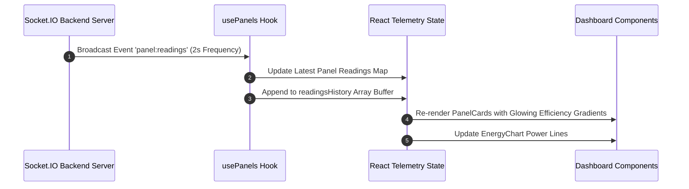
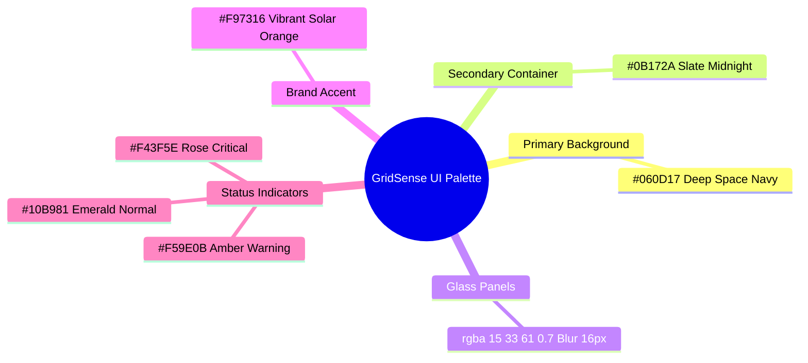

# 🖥️ GridSense Frontend Subsystem — System Architecture Guide

> **Enterprise Next.js 15 Web Application with Real-Time Socket.IO Hydration, Floating Glassmorphic AI Copilot, and `Plus Jakarta Sans` Typography.**

---

## 📐 Frontend Subsystem Architecture Flowchart

```mermaid
flowchart TB
    subgraph Core ["Next.js 15 App Router Layer"]
        Layout["Root Layout (Plus Jakarta Sans Font)"]
        DashboardPage["Dashboard Page (/dashboard)"]
        PanelsPage["Panel Details Page (/dashboard/panels/[id])"]
        BillingPage["Billing Page (/dashboard/billing)"]
    end

    subgraph StateAndHooks ["Custom Hooks & State Hydration"]
        AuthHook["useAuth Hook (JWT Token Management)"]
        SocketHook["useSocket Hook (WebSocket Connection)"]
        PanelsHook["usePanels Hook (Real-time Telemetry Buffer)"]
    end

    subgraph Components ["Glassmorphic Component Architecture"]
        StatsBar["StatsBar Component (Glowing Radial Badges)"]
        PanelGrid["PanelGrid & PanelCard Component (Efficiency Bars)"]
        AlertFeed["AlertPanel Component (Active Fault Feed)"]
        EnergyChart["EnergyChart Component (Recharts Power Curves)"]
        CopilotWidget["CopilotChat Widget (Glassmorphic AI Drawer)"]
      End

    Layout --> AuthHook
    AuthHook --> SocketHook
    SocketHook --> PanelsHook
    PanelsHook --> DashboardPage
    
    DashboardPage --> StatsBar
    DashboardPage --> PanelGrid
    DashboardPage --> AlertFeed
    DashboardPage --> EnergyChart
    DashboardPage --> CopilotWidget
```

---

## 🤖 Floating AI Copilot Widget Lifecycle (`CopilotChat.tsx`)


---

## 📡 Real-Time Socket Telemetry Hydration Flowchart



---

## 🎨 Glassmorphic Design System & Tokens

GridSense uses a dark design system with glowing accents:



---

## 🚀 Frontend Development & Production Commands

```bash
# Navigate to client directory
cd client

# Install Dependencies
npm install

# Run Development Server (http://localhost:3000)
npm run dev

# Compile Production Build
npm run build
```

---

## 📄 Component Structure Overview

* `app/layout.tsx`: Root HTML layout importing `Plus Jakarta Sans` Google Font and global glassmorphic styles.
* `app/(dashboard)/dashboard/page.tsx`: Main telemetry dashboard container coordinating metrics and socket state.
* `components/CopilotChat.tsx`: Floating AI Copilot chat drawer with quick prompts and glassmorphism styling.
* `components/dashboard/PanelCard.tsx`: Glassmorphic solar panel card featuring glowing efficiency progress bars and fault badges.
* `components/dashboard/StatsBar.tsx`: High-contrast metrics row with radial glowing icons.
* `components/dashboard/EnergyChart.tsx`: Live array power curves rendered via Recharts.
