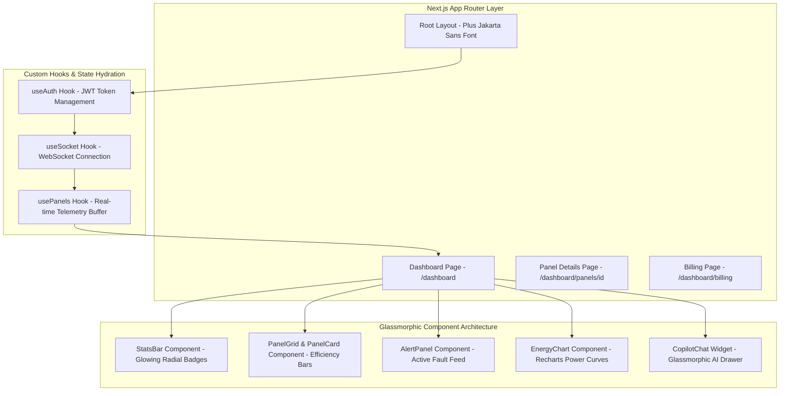
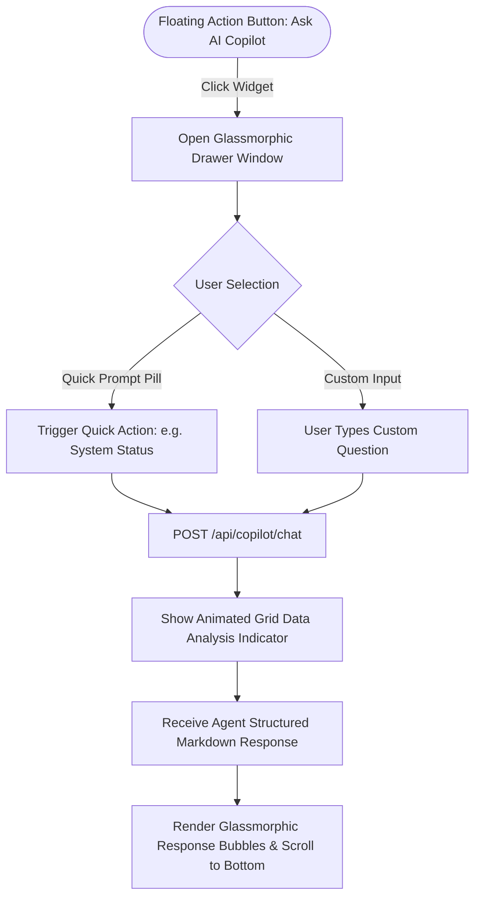
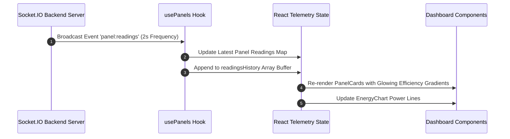
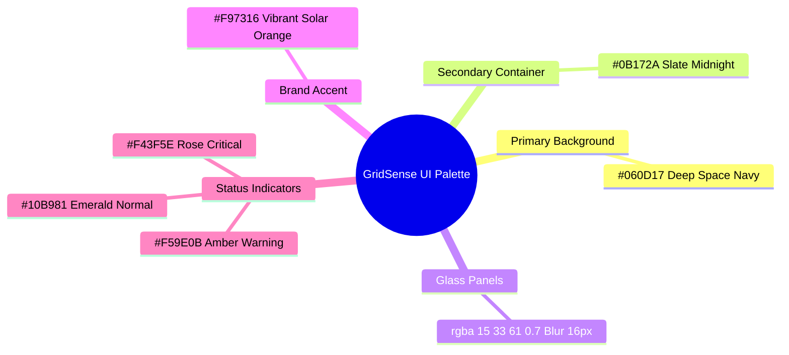

# 🖥️ GridSense Frontend Subsystem — Deep Architectural Blueprint

> **Enterprise Next.js 15 Web Application with Real-Time Socket.IO Hydration, Floating Glassmorphic AI Copilot, `Plus Jakarta Sans` Typography, and Vercel Deployment.**

[](https://nextjs.org/)
[](https://react.dev/)
[](https://tailwindcss.com/)
[](https://recharts.org/)
[](https://socket.io/)
[](https://vercel.com/)

---

## 🌟 Frontend Architectural Overview

The **GridSense Frontend Subsystem** is an enterprise real-time dashboard built to monitor solar farm telemetry, visualize live array power curves, display active grid fault alerts, and interact with the autonomous AI Copilot.

### 💡 Core Engineering Capabilities
1. **Hybrid Next.js 15 App Router Architecture:** Utilizes Server-Side Rendering (SSR) for instant page hydration ($<400\text{ms}$ FCP) paired with scoped Client Component boundaries (`'use client'`) for interactive socket widgets.
2. **Real-Time WebSocket State Hydration (`usePanels.ts`):** Custom hooks buffer high-frequency 2-second telemetry streams using functional state setters, eliminating parent component re-renders.
3. **Floating Glassmorphic AI Copilot Widget (`CopilotChat.tsx`):** Features one-click quick prompt chips (⚡ *System Status*, 🚨 *Active Alerts*, ✨ *Panel Beta Health*, 🛠️ *Error E01 Guide*), auto-scrolling message views, and agent execution loading states.
4. **Optimized Power Curve Visualizations (`EnergyChart.tsx`):** Renders real-time array power outputs using Recharts with memoized historical data slicing and `isAnimationActive={false}` to eliminate 300ms CSS stroke lag.
5. **Glassmorphic Dark Design System (`app/globals.css`):** Styled with Google Font `Plus Jakarta Sans`, translucent backdrop blurs (`backdrop-blur-xl`), glowing radial shadows, and high-contrast status badges.

---

## 📐 Frontend Architecture Flowchart



---

## 🤖 Floating AI Copilot Widget Lifecycle (`CopilotChat.tsx`)



---

## 📡 Real-Time Socket Telemetry Hydration Flowchart



---

## 🎨 Design System Tokens & Color Palette

GridSense follows modern enterprise dark-mode aesthetics:



---

## 📁 File-by-File Codebase Directory Architecture

| File Path | Primary Responsibility |
| :--- | :--- |
| **`app/layout.tsx`** | Root layout loading Google Font `Plus Jakarta Sans`, Razorpay SDK, `AuthProvider`, and `ToastProvider`. |
| **`app/globals.css`** | Tailwind directives, `.glass-panel` backdrop blurs, glow utilities, and custom scrollbars. |
| **`app/(dashboard)/dashboard/page.tsx`** | Main telemetry dashboard coordinating real-time hooks, expiry notices, and dashboard views. |
| **`app/(dashboard)/dashboard/panels/[id]/page.tsx`** | Individual panel diagnostic view displaying granular voltage, current, power, and thermal gauges. |
| **`app/(dashboard)/dashboard/billing/page.tsx`** | Subscription billing center displaying plan cards (`FREE`, `PRO`, `ENTERPRISE`) and payment histories. |
| **`components/CopilotChat.tsx`** | Floating AI Copilot drawer with quick action chips, auto-scrolling message views, and loading states. |
| **`components/dashboard/PanelCard.tsx`** | Glassmorphic panel card with glowing efficiency progress bars, telemetry readouts, and fault icons. |
| **`components/dashboard/StatsBar.tsx`** | High-contrast metric cards with radial glowing icons displaying power, generation, and health scores. |
| **`components/dashboard/AlertPanel.tsx`** | Vertical live fault feed component displaying severity badges (`CRITICAL`, `WARNING`). |
| **`components/dashboard/EnergyChart.tsx`** | Live power output chart rendered via Recharts with memoized historical data slicing. |
| **`hooks/useAuth.ts`** | Authentication context hook managing JWT token state and `localStorage` persistence. |
| **`hooks/useSocket.ts`** | Socket.IO connection hook managing WebSocket connections and authentication handshakes. |
| **`hooks/usePanels.ts`** | Telemetry hydration hook buffering 2-second readings in React state without parent re-renders. |
| **`lib/api.ts`** | Axios HTTP client instance configuring base URLs and automatic JWT Bearer request headers. |

---

## 🚀 Development & Production Build Commands

```bash
# Navigate to client directory
cd client

# Install Dependencies
npm install

# Run Development Server (http://localhost:3000)
npm run dev

# Compile Production Build
npm run build
```
